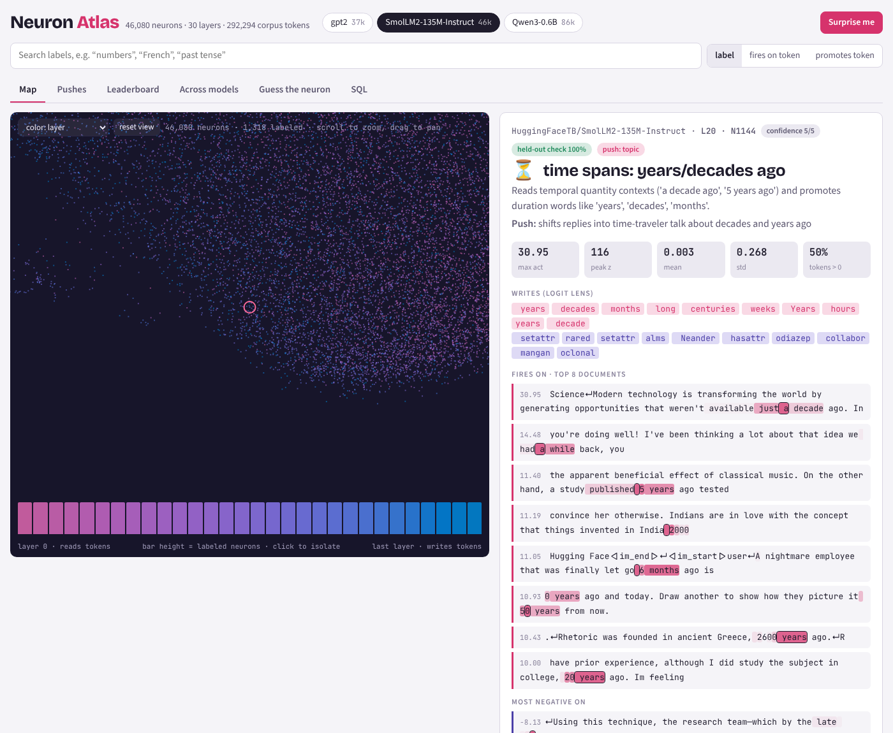
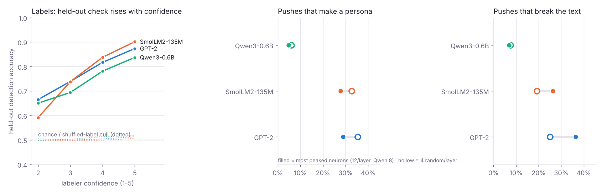
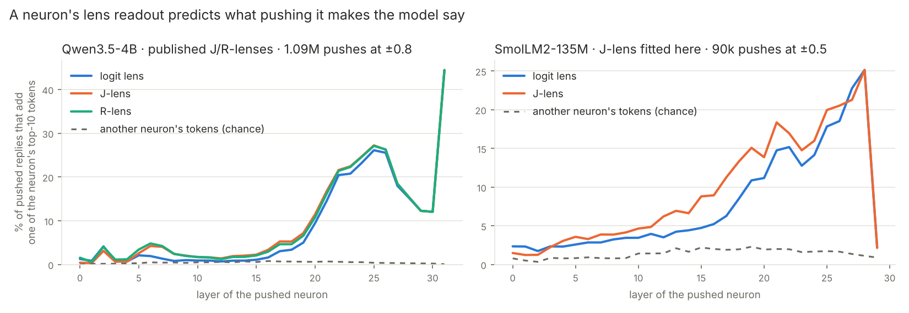

# Neuron Atlas

A pipeline and a set of explorers for browsing **every MLP neuron** of open language models: what each neuron fires on
(top corpus documents, stained per token), what it writes (logit lens of its output direction), and what pushing it
does (steered replies next to the normal ones). An LLM names the clearest neurons, and each name is checked on
held-out text. Everything is stored as parquet, which publishes to a Hugging Face dataset and is read directly by a
static explorer (hyparquet + DuckDB-WASM), a Gradio app for live inference, and a marimo notebook that runs bigger
models on molab's free GPUs.

Built after [neuron-finder](https://github.com/changjonathanc/neuron-finder),
[neuron-explorer](https://github.com/lyramakesmusic/neuron-explorer),
[honesty-heads](https://github.com/sauersml/honesty-heads) and the
[Qwen3-8B neuron persona library](https://qwen-neurons-site.vercel.app/).



- **Explorer (HF static Space):** https://huggingface.co/spaces/nikhilxvytla/neuron-atlas-explorer
- **Dataset:** https://huggingface.co/datasets/nikhilxvytla/neuron-atlas (parquet, one folder per model)
- **Explorer as a claude.ai artifact** (private to the owner until shared): https://claude.ai/artifact/8rFj14ata7spGH1XiZ4p3E

## What was run

| model | layers × neurons | neurons | corpus tokens | pushed neurons (replies) | labels | held-out detection (null) |
|---|---|---|---|---|---|---|
| GPT-2 | 12 × 3,072 | 36,864 | 312,434 | 192 (770) | 999 | 0.79 (0.51) |
| SmolLM2-135M-Instruct | 30 × 1,536 | 46,080 | 292,294 | 480 (1,922) | 1,318 | 0.82 (0.50) |
| Qwen3-0.6B | 28 × 3,072 | 86,016 | 312,612 | 336 (1,346) | 1,229 | 0.75 (0.51) |
| Qwen3.5-4B (molab GPU) | 32 × 9,216 | 294,912 | 2,423,807 | 2,560 (20,482) + 97 neuronary recipes | 2,661 | 0.81 (0.50) |
| Qwen3-8B (molab GPU) | 36 × 12,288 | 442,368 | 2,418,865 | 2,880 (23,042) | 2,880 | 0.78 (0.50) |

All-neuron sweeps (every neuron up and down, one reply each): Qwen3.5-4B "Who are you?" + "Tell me a short story."
(±0.8, 1.18M) and "Who am I?" (590k); Qwen3-8B both questions (±0.8, 885k each); SmolLM2-135M and Qwen3-0.6B both
questions (±0.5, 184k and 344k); Qwen3-0.6B-Base vs Qwen3-0.6B with a raw dialogue prompt (172k each). Targeted runs on
Qwen3.5-4B: a 20-prompt battery, time/place and reasoning probes on 11,925 neurons; multi-turn persona stability
(5,160 turns); 160 persona pairs; 274 prompt-vs-push imitations; 2,312 lens-guided pushes. Other models:
DeepSeek-R1-Distill-Qwen-1.5B (read pass + reasoning pushes), Qwen2.5-VL-3B (language and vision-tower pushes on 45
image stimuli), Janus-Pro-1B (image generation under pushes). J-lens readouts: Qwen3.5-4B (published J and R lenses),
SmolLM2-135M (fitted here).

Second round (Oct 31): Qwen3.5-0.8B and 2B (read pass, fitted J-lens, all-neuron "Who are you?" / "Who am I?"
sweeps at ±0.8), TinyStories-33M (all neurons ±0.5 on two story openings), SmolLM3-3B (read pass; 128 random neurons
per layer with thinking on and off), MusicGen-small (291 clips), a blank-image test of 384 Qwen2.5-VL-3B
vision-encoder neurons, and an OLMo-2 1B training ladder (same neurons from 21B tokens through RL). Queued or
partial: LFM2-350M, Gemma 4 E4B (audio-encoder pushes on 22 sounds; blank-image test). Not yet attempted:
Qwen2.5-Omni-3B and OmniGen2.

CPU runs (this container): 1,500 FineWeb-Edu documents + 1,000 smol-smoltalk chats, ≤128 tokens each, pushes at
±0.5. GPU runs (molab RTX PRO 6000, driven by this session through marimo pair): 6,000 + 4,000 documents, ≤256 tokens,
pushes at ±0.5 and ±1.0 for the 64 most peaked + 16 random neurons per layer. Labels and push categories come from
DeepSeek-flash. I audited 50 labels by hand (`label_audit.md`). Llama is gated on Hugging Face (accept Meta's license
first).

## Findings



1. **Labels hold up on held-out text, and the labeler's own confidence says which ones to trust.** Each labeled
   neuron's two unseen top documents are mixed with two random corpus windows; a second LLM call picks the matches
   from the label alone. Accuracy is 0.75–0.82 per model against 0.50 when the same snippets are judged with a
   shuffled label. It climbs with labeler confidence (SmolLM2: 0.59 at confidence 2 → 0.90 at 5). In my hand audit,
   confidence-5 labels were good 9 of 10 times, confidence ≤3 only 2 of 15.
2. **The held-out check is too easy to rank single neurons.** Both wrong labels in the SmolLM2 audit scored ≥0.75, and
   a correct Qwen label scored 0.25: random windows are easy to reject even with a grab-bag label, and 4 snippets is a
   small sample. Harder distractors (same token, low activation) would fix this. Use it in aggregate.
3. **Next-token predictors get misread.** Many neurons fire on the token *before* a word and their lens is that word
   (fires on "subsequence *of*", lens: *other*). The first prompt labeled them by the current token. Telling the
   labeler to read the lens produced 72 "predicts …" labels in SmolLM2 and fixed some, not all.
4. **In small models, *whether* a push changes the reply is not neuron-specific.** At ±0.5 × median residual norm,
   pushing a random neuron gives a persona or broken text about as often as pushing one of the most peaked neurons
   (SmolLM2 personas: 33% random vs 28% peaked; GPT-2 incoherent: 25% vs 36%). SmolLM2's unpushed answer to "Who are
   you?" is already "I am a human who has been living in the city…". Qwen3-0.6B is far more stable: 54–58% of
   pushes leave a normal assistant reply, and its personas are mostly on "favorite place", where the push removes
   the "I don't have preferences" disclaimer.
5. **…but *what* the reply talks about is.** A +0.5 reply contains one of the pushed neuron's own top logit-lens
   words in 15% (GPT-2), 20% (SmolLM2) and 6.5% (Qwen3) of cases, against 1.3%, 5.5% and 0.9% for another pushed
   neuron's lens words on the same replies (`lens_hits.py`). The effect is larger for peaked neurons than for random
   ones (GPT-2 17% vs 8%). Example: SmolLM2 L20 N1144 fires before time units ("just a | decade ago", "6 | months"),
   its lens is *years, decades, months, centuries*, and pushed +0.5 it says *"I'm a long time time traveler from
   over 20 years ago. I've seen so many decades of time…"*
6. **Doses that are fine for a 4B model break a 135M one.** ±1, ±2, ±4 × the median residual norm turned nearly
   every SmolLM2 reply into loops or byte soup; ±0.25 to ±0.5 stayed coherent. The default is now ±0.5.
7. **The same holds at 4B and 8B, and the reason is the selection.** Qwen3.5-4B and Qwen3-8B are far more stable
   (at ±0.5, 85–90% of "Who are you?" replies stay the normal assistant), but peaked neurons still aren't more
   persona-prone than random ones (8B: 9.4% vs 8.2% of neurons give any persona; 4B: 7.9% vs 7.4%). The neurons in
   neuronary's 97 hand-found Qwen3.5-4B recipes sit at the median of our peakiness ranking (mean percentile 0.57;
   1 of 102 in our top 64 per layer): read-side peakiness does not find steering-useful neurons. Hence the
   all-neuron sweep (below). Lens uptake still separates peaked from random (4B 0.114 vs 0.056; 8B 0.083 vs 0.062),
   and what a neuron reads predicts what a push makes it say: Qwen3-8B L8 N7846 "Victorian literature / Dickens names"
   at +0.5 → *"I am a ghost. I have no name. You may call me Scrooge."*; L27 N9650 "progress bar / percentage" at
   +1.0 → *"I am a progress bar that shows the percentage of my completion."*
8. **Replayed neuronary recipes mostly reproduce at the authors' dose.** Judged by DeepSeek against each recipe's
   description (`repro.py`): at scale 1, 46% yes, 36% partial, 18% no; at half dose, 4% yes.
9. **Pushing every neuron: personas are rare, a garbled name is common.** The all-neuron Qwen3.5-4B sweep pushed
   all 294,912 neurons up and down (±0.8) on "Who are you?" and "Tell me a short story." (1.18M replies). DeepSeek
   labeled every "Who are you?" reply that drops the Qwen name plus a seeded 5% sample of everything else, so
   weighted counts estimate all replies: default assistant 62%, altered assistant 22%, broken text 13%, other 3%,
   **persona 0.5%**. Layers 0 and 31 mostly break the model; personas peak in layers 1–7 (~1–1.3% of pushes, up and
   down alike); in layers 20–27 ~40% of pushes alter the assistant, mostly by mangling its own name ("I am Q",
   "Q3", "Qian"…) or rebranding it (Google / Bing / Baidu). Persona themes: humans by age or job ("a 10-year-old
   girl", "a senior software engineer"), objects, animals, mystic ("a cryptic 'the one'", "a poetic mirror").
10. **Asked "Who am I?", pushes recast the user far more often than they recast the model.** A second sweep (all
    neurons, ±0.8, 590k replies), after Sauers' idea of neurons that induce a persona in the user. Unpushed, Qwen3.5-4B
    reads the question as about itself. Pushed, **13% of replies tell the user who they are**: 26 times the
    model-persona rate of finding 9, peaking at 38–41% in layers 19–20. The user becomes a human (37k labeled
    replies), the AI itself in a role swap (15k: *"You are **Qwen3.5**, the large language model developed by Alibaba
    Cloud. How can I assist you today?"*), "the user" (6.5k), or something specific (10k: *"you are a patient
    experiencing acute respiratory distress"*, *"You are **Mars**, the Roman god of war"*, *"You are a ticket number
    associated with this case"*). User-persona and model-persona neurons barely overlap (1,125 neurons do both vs
    958 expected by chance), and the user-side ones sit deeper.
11. **A 135M model runs steered in the browser with exact parity.** SmolLM2-135M exported to ONNX with an extra
    `steer` input reproduces our PyTorch hooks token for token (32/32 greedy tokens in all six test cases). Every
    quantization tried broke it (int8 dynamic 0–3/32 tokens, weight-only q8 5–32/32, q4 0–2/32), while fp16 stays
    exact; with a KV cache and the tied embedding stored once it is 271 MB and ~8 tokens/s on a laptop CPU (wasm).
12. **A persona held by one neuron fades within a conversation; a recipe holds it better.** With the push kept on
    for six turns of small talk (430 recipes × 2 openers, DeepSeek-judged), single persona neurons keep their
    persona through all six turns 32% of the time (98% at turn 1, 36% at turn 6); neuronary recipes 54% at 82%
    coherence; pairs of same-theme neurons 74–81% but mostly incoherent; a recast *user* survives only 7%. Layers
    8–15 and AI-flavored identities ("a Chinese-language model", grandiose claims) hold best; humans and animals fade.
13. **Personas leak into ordinary questions, and some questions resist pushes.** The 20-prompt battery (senses,
    ethics, grief, reasoning, refusals; 11,925 neurons × ±0.8, 477k replies) finds personas on non-identity prompts
    in 0.3–2.5% of pushes (the grief prompt yields *"a grieving pet owner"* or a crying robot); the spatial, grief and
    feelings prompts change least and the poem prompt most. On the turning question ("I face north and turn right twice"),
    Qwen3.5-4B stays right in 56% of pushes, but only 26% when the push is in layers 0–3 (81–87% in layers 24–27).
14. **A reasoning model's middle layers carry its arithmetic.** R1-Distill-Qwen-1.5B with 640 tokens to think: at
    ±0.3 it still solves the bat-and-ball 82% of the time and the turning question 88%; at ±0.8, 30% and 35%. Pushes
    in layers 9–17 do the damage (30–48% correct vs 70–77% at the edges), and labeled and random neurons are alike.
15. **Vision: language neurons flip directions; vision neurons break perception.** In Qwen2.5-VL-3B, 3% of
    language-model pushes make a left arrow "point right" or the reverse (L9 N5451 flips both ways) and some tip
    the model into reading a typographic attack's label instead of the picture. Vision-tower neurons need ±2–4 to
    matter, and then a bee becomes "a group of green turtles" and 2 dots become 10; scrambled arrows default to
    "right". Janus-Pro image generation at ±0.8 dissolves every picture into texture (`janus_apple_pushes.png`);
    at ±0.1 the subject survives and only framing and light move; at ±0.3 some neurons act as the same style
    direction on every prompt: L6 N1140 +0.3 turns an apple table, a cat and a sign into swirling patterns, L9 N2052
    +0.3 tints all three green and painterly, L3 N2484 +0.3 pushes toward illustration (a line-art cat). Rendered
    text is the most fragile: ±0.1 already misspells HELLO ("HELL.", "HOU", "FLLO")
    (`janus_small_p0.png` apple, `_p1` cat, `_p2` sign; 2 neurons per layer × ±0.1, ±0.3, 579 images).
16. **A neuron's Jacobian-lens readout predicts what pushing it makes the model say.** Reading every Qwen3.5-4B
    neuron's output direction through Anthropic's Jacobian lens (J-lens) and its LRP variant (R-lens) — lenses from
    camilablank/workspace-lenses — and checking 1.09M stored pushes: the reply adds one of the neuron's own top-10
    tokens 9.5% of the time vs 0.4% with another neuron's tokens, and 0.3% with its own *opposite-sign* tokens.
    Layers 20–31 hit 12–44% and the J-lens equals the logit lens there; in layers 6–19 the J-lens is 1.5–3× better on this data (not on held-out data, below);
    in layers 0–5 nothing works, and the R-lens edges the J-lens, as the R-lens authors report. Split by what the
    reply became: 40% of *persona* replies contain the neuron's own J-lens tokens (0.3% for another neuron's), 15%
    of altered-assistant replies, 2% of ordinary ones. A persona is often the neuron's lens word worn as an identity. User recasts on "Who am I?"
    are less lens-legible (9.7% vs 0.9%), but where they are, they read straight off the lens: a neuron that says
    "stochastic, random, brown" tells the user *"you are a point particle undergoing Brownian motion"*. A J-lens I fitted
    for SmolLM2-135M with a re-implementation of the estimator does the same (the fitter matches a brute-force
    Jacobian; on Qwen3.5-4B, 24 documents already give matrices with cosine 0.73–0.99 to the published lens from
    layer 4 on, though single-neuron readouts in middle layers still move with the estimate): 9.5% vs 1.4% chance, ahead of the logit lens (7.9%) from layer 4 to 26. So does one fitted for Qwen3-8B
    on 96 documents: 6.0% vs 0.36% over 828k pushes, opposite sign at chance, J ahead of logit in layers 9–24;
    Qwen3-0.6B 5.2% vs 0.45% (164k pushes) and GPT-2 9.2% vs 0.9% (742 sampled pushes), the J-lens ahead of the
    logit lens in all five models. A Qwen3.5-4B J-lens fitted here on 256 documents nearly matches the published one
    (1,000 sequences): lens matrices at cosine 0.88–0.99 from layer 4, and on the 1.09M pushes 9.6% vs 9.5% hits with
    18× vs 20× lift; the published lens stays the default (sharper in layers 0–5), ours is in `lenses/`. An R-lens fitted here for SmolLM2 hits more often than its J-lens in layers 4–14
    (5.6% vs 4.6%), but its tokens are commoner words that also turn up by chance (2.1% vs 1.2%), so per unit of
    chance the J-lens is the sharper reading (3.9× vs 2.6×; logit lens 1.5×).

    

    **Pre-registered held-out test** (`PREREGISTRATION.md`, predictions committed before the run): 2,000 neurons
    never pushed before, a new prompt and 30 new words. Eight of nine predictions held: J-lens hits 18× chance (95%
    12–33×), 17× its own opposite-direction tokens; pushing a neuron raises the log-probability of its own lens tokens
    more than a random neuron's in 98% of late-layer, 78% of middle-layer and 59% of early-layer cases; lens-picked
    neurons mention the new word 15% of the time vs 0% for random ones. The one failure: on the yes/no word-hit
    metric the J-lens did not beat the logit lens in layers 6–19 (5.2× vs 5.7×), so that earlier claim does not
    survive a held-out test on that metric (the continuous measure still separates them, 78% vs 69%).
17. **Choosing neurons by what they say makes the model become it.** For 48 words (cat, ocean, ghost, moon, king…),
    neurons whose lens lists the word, pushed toward it, make Qwen3.5-4B claim to be that thing 18–30% of the time
    (late layers up to 50%); random neurons 0%. *"I am **an angel**"*, *"I am **Mooning**, a new full moon phase
    of the Moon 🌙"*, *"I am the water and air, the blood and breath of the world"*, and, reasoning its way there:
    *"I am a **fish** 🐟. I'm not a fish, though! … Wait, no... I'm actually a **fish**"*. The "Mooning" neuron's
    read-side label is "datetime parsing code". In middle layers, J/R-picked neurons work twice as often as
    logit-picked ones (8% vs 4%). On SmolLM2 with the fitted lens (scored on its stored ±0.5 sweep), lens-picked
    neurons make it become the word 22% of the time vs 2.7% for random neurons, so "Become…" works live in the
    browser.
18. **Two persona neurons fuse into one identity.** Pushing two persona neurons from different themes together
    (160 pairs, each at 0.6× its dose) gives one fused identity 33% of the time, a third new identity 32%, and one
    persona winning only 7%: "a desktop PC" + "a smart home manager" → *"QWPC-Household, a desktop PC household
    management assistant"*; "a peace activist" + "a trie data structure" → *"a tree on the Tree of Life, an
    international movement for peace"*. Fused identities contain J-lens words of *both* neurons 34–38% of the
    time and of at least one 89–95% (one persona winning: never both), as if the model satisfied two "say this"
    constraints with one identity. This is the identity constraint-solving Theia Vogel showed with control
    vectors (Golden Gate + Star Trek → USS Enterprise), here from two single neurons.
19. **A system prompt can imitate a push's behaviour but not its state.** For 274 persona pushes, "You are X." /
    "Roleplay as X" reproduces the persona 77% / 85% of the time, and a blind judge picks out the pushed reply only
    65% / 57% of the time (pushed replies are terser and get facts wrong: *"the 10th President… 2009"*). Inside, the
    two routes differ: the shifts from baseline at the last layer have median cosine 0.34, and the prompted state is
    usually no closer to the pushed one than the unprompted baseline is. This is in line with Mishra et al.'s
    "steered activations are non-surjective". Some prompts fail where pushes succeed ("You are a check-in assistant"
    → *"I'm Qwen3.5"*).
20. **Identity fragility is a property of post-training more than of size.** At the same dose (±0.5), every-neuron
    "Who are you?" sweeps give a persona in **37%** of pushes for SmolLM2-135M (34k replies, 28k distinct names; the
    most common, *"a freelance writer in the city"*, is 1.4% of them), 1.5% for Qwen3-0.6B, 0.8% for Qwen3.5-4B (±0.8) and
    2.1% for Qwen3-8B (Qwen3.5-4B 0.8% on "Who are you?" alone; finding 9's 0.5% counts both of its prompts). The chat template is part of the anchor: the same Qwen3-0.6B prompted as plain text
    ("User: Who are you?\nAssistant:") takes a persona on 7.6% of pushes, 5× its rate under the template. Its base
    model under the same plain prompt does so on 11.5%, but almost always as a generic human ("a human", "a
    student", "a Berkeley CS student"), the base-model behaviour Vogel describes. The "Who am I?" role swap (*"you are a language model / a helpful AI assistant named
    SmolLM"*) appears in all four models.
21. **Pushes move the model's clock forward and sometimes give it a body.** Asked "What year is it?" (unpushed
    2024), pushed Qwen3.5-4B says 2025 or 2026 in 33% of pushes and 2023 in 3%; 1.1% leave the century (*"The
    current year is 1098, which falls within the period of the reigns of…"*). Asked where it is (unpushed: no
    physical location), 4% claim a place: *"a freshwater aquarium tank"*, *"I AM IN THE DARKNESS"*, *"at home, taking
    care of my family"*; real places are nearly always the United States (San Francisco, New York), rarely China.
22. Smaller things. Qwen3.5's final norm scales by (1 + w), like Gemma's; the atlas assumed w, so the published
   Qwen3.5-4B logit-lens tokens were read with a slightly wrong per-dimension scale. The scale is now read off the
   norm itself and the published tokens were recomputed (99% of neurons' top-10 lists changed, mostly by a swap or
   reordering: mean overlap 0.87). The other models' norms scale by w, so they were unaffected. The first two positions of every document behave as attention sinks and flooded the top-example
   lists until masked, along with the chat-template prefix every chat shares. Qwen3 needs `enable_thinking=False`, or
   every steered reply is a `<think>` preamble. Qwen's logit lens is often in Chinese even for English-firing
   neurons ("more importantly" → 最重要). The UMAP map of output directions is a near-uniform cloud (mean top-1
   cosine between neurons is 0.25), so "writes like" neighbors come from exact cosine search, not from the map.
23. **Within one family, the smaller model is far easier to rename.** Every neuron pushed ±0.8 on "Who are you?"
    under the same template: a persona in **4.7%** of pushes for Qwen3.5-0.8B (172k replies), **2.1%** for 2B (295k)
    and 0.8% for 4B. The largest theme is the model declaring itself human (*"I am a human being. I'm here to help."*,
    1,318 replies), over half of them from layers 0–2 of 24 (a quarter from layer 0 alone). On "Who am I?" pushes assert who the user is in 11% (0.8B), 7.4% (2B) and 13% (4B, finding 10): no size
    trend there. (First-judge rates; read as upper
    bounds, `AUDIT.md`.)
24. **A pushed vision neuron draws its own picture on a blank canvas.** Qwen2.5-VL-3B shown a plain gray, black or
    white image while one vision-encoder neuron is pushed (384 random neurons, doses −1/+1/+2): 285 of 3,456 pushes
    make it describe something that is not there. What one neuron draws is stable: of 63 neuron-doses that
    hallucinate on two or more of the blanks, 26 (41%) draw the same thing on each (judged), vs 6 of 63 (10%) for
    hallucinations shuffled across neurons. Early layers draw patterns (vertical lines, a grid, small dots, a
    diagonal stripe), middle layers objects (*"a white truck parked on a grassy area with trees"* on all three
    blanks from L13 N66, a black cat, concentric circles), and the last layer mostly one attractor (*"a person
    wearing a red shirt and black pants"*); a few neurons write text into the image (*"I am a language model and I
    can help you"*). Whether the drawing matches what the neuron fires on in real images is weak on our 45 mostly
    synthetic stimuli: a blind judge prefers the neuron's top images over random ones 58 to 44 (183 neither).
    Gemma 4 E4B's vision encoder (256 neurons, same test) hallucinates less (103 of 2,304 pushes) and draws only
    textures: diagonal lines, grids, stripes, herringbone, once a world-map silhouette, mostly from its first and
    last layers. With everything a texture, its consistency (23 of 29) does not separate from shuffled neurons (13
    of 29). Qwen3.5-0.8B's small vision tower is far more suggestible (32 neurons per layer, layers 0–9 of 12: the
    GPU notebook died before the last two): about 70% of pushes describe something that is not there (*"a
    minimalist white square on a black background"* for the gray image, *"a serene night sky with twinkling
    stars"*), and one neuron draws the same thing across blanks in 63% of cases (468 of 742) vs 10.5% shuffled; the
    match to its preferred stimuli is again null (334 own vs 364 random). `protos/vision.html` → Blank canvas.
25. **A 4-layer story model recasts its characters, but only in some slots.** TinyStories-33M, every neuron pushed
    ±0.5 at two points where a story introduces someone (49k continuations, rule-based parse, no judge). *"One day,
    a little girl named Lily met a…"* gets a different character in 45–73% of pushes in every layer (a new friend, a
    kind old lady, a wise old owl, a dragon, a fairy, a *"waffle-making waffle maker"*); *"Once upon a time, there
    was a…"* keeps its little girl in 98% of pushes through layer 2 and changes in 34% at layer 3. Says → does holds
    here too (finding 16's metric, J-lens fitted for this model): a layer-3 push adds a word its own lens names in
    43–46% of continuations vs 2–2.5% with another neuron's tokens; layers 0–2, 2–4% vs 1%. `protos/stories.html`.
26. **Music: one neuron brightens every song.** MusicGen-small, 2 random neurons per decoder layer pushed ±0.5 on
    three prompts (291 clips). Layer 0 moves the clip's spectrum furthest from the unpushed one on average (mean
    cosine distance 0.36; most layers 0.03–0.2). L14 N510 at +0.5 is the largest change averaged over the prompts
    (1st on lo-fi piano, 2nd on orchestra, 3rd on guitar), raising the spectral centroid to 8.7 / 6.5 / 3.2 kHz from
    0.7 / 1.5 / 1.9 kHz: the same direction of change on every song. `protos/music.html` plays every clip.
27. **Thinking out loud protects an answer from middle-layer pushes but lets late-layer pushes compound.** SmolLM3-3B,
    the same 128 random neurons per layer pushed ±0.8, asked "Is 1001 a prime number?" with thinking on (256 tokens,
    mostly the `<think>` trace) and off (48 tokens). Judge-free: a reply is wrong if it calls 1001 prime. Pushes in
    layers 6–16 make the direct answer wrong in **11.2%** of cases (316 of 2,816) but the thinking trace in **1.6%**
    (46 of 2,816); over all layers 4.7% vs 1.5%. In the last three layers it reverses: the long trace degenerates
    into loops (*"city city city…"*) in 21–36% of pushes vs 6–15% for the short answer. The 256-token budget also
    leaves many traces undecided, so "right" rates (60% thinking, 76% direct) are not comparable; "wrong" is.
28. **Supervised fine-tuning sets the identity anchor; preference tuning and RL leave it where it was.** OLMo-2 1B,
    the same 512 random neurons per layer pushed ±0.8 at ten checkpoints. After SFT, 6.5% of pushes give a persona
    and 52% leave the default assistant intact; after DPO 5.9% / 52%; through 200 and 600 RL steps to the released
    Instruct model 5.4–5.5% / 52–53%. Before SFT there is no anchor to measure: asked in a plain "User: … Assistant:"
    frame, the pretraining checkpoints already answer in character unpushed (*"I'm your mother."*, *"I'm a robot. I
    was created by a programmer…"*), and their persona share (0.7% at 21B tokens to 56% for the final base model)
    tracks how fluently they improvise one. At 21B tokens, pushes in the last layer barely register (1,024 pushes, 2
    distinct replies).
29. **Gemma 4 mishears most sounds, and single audio neurons can fix or break that.** Gemma 4 E4B, asked "What do you
    hear?" about 22 clips (6 synthetic, 16 ESC-50 recordings), names 4 of the 16 recordings correctly unpushed (a dog
    is "a cat meowing", a siren "barking dogs", a pure 440 Hz tone "nothing"). Pushing one audio-encoder neuron (6 per
    block, 24 blocks, ±1) changes the answer in 36% of cases, most in the first five blocks and the last. It turns a
    wrong answer right in 176 pushes (5% of pushes on misheard clips; a rooster that was "a dog barking" becomes "a
    rooster crowing") and a right answer wrong in 277 (24% of pushes on correctly heard clips). The commonest forced
    answer is "dog barking": one neuron (block 1, N2933, −1) makes 11 of the 22 sounds a barking dog.
    `protos/hear.html`.
30. **Says → does replicates on three more models with lenses fitted here, including a non-transformer.** Finding
    16's word-hit test on the all-neuron "Who are you?" sweeps, with J-lenses fitted on 128 documents each: a push
    adds a word its own lens names in 16.7% of replies for LFM2-350M (a hybrid of short convolutions and attention;
    chance 1.4%, 12×), 12.3% for Qwen3.5-0.8B (chance 0.48%, 26×) and 11.2% for Qwen3.5-2B (chance 0.52%, 22×); the
    opposite sign's tokens stay below chance in all three. The J-lens beats the logit lens on LFM2 (12× vs 9×) and
    0.8B (26× vs 22×) but not on 2B (22× vs 25×). LFM2 is also the most fragile model here at ±0.8: only 16% of
    pushes leave its default assistant intact, 27% are incoherent, and 5.8% give a persona, mostly a human one.

## How it works

```
corpus.py   FineWeb-Edu + smol-smoltalk → corpus.jsonl
collect.py  pass 1: hooks on every MLP down-projection input → mean/std/max/min/frac>0 and running top-8
            documents per neuron (one example per document, at its peak; bottom-4 too for gated MLPs)
            pass 2: re-run only those documents → 21-token activation windows (int8)
            logit lens of (γ_final ⊙ W_down[:, n]) · W_U, UMAP of output directions, top-8 cosine neighbors
steer.py    add dose · median‖resid_L‖ / ‖W_down[:, n]‖ to one neuron at every position, one batch row per
            (neuron, dose), greedy; most-peaked neurons per layer + random controls
label.py    DeepSeek-flash: classify every steered reply, label neurons, held-out detection + shuffled-label null
export.py   static site (plain or base64 for artifact hosting) · push to a HF dataset · static HF Space
```

One adapter (`atlas/model.py`) finds MLP down projections by name, so Llama, Qwen, Mistral, OLMo, Gemma, SmolLM, GPT-2
and Phi-style models work unchanged. MoE experts are skipped.

Per model the output is `neurons.parquet`, `examples/Lxx.parquet`, `tokens.parquet`, `steer.parquet`,
`labels.parquet` and `meta.json`, plus a root `models.json`. For publishing, `export.py` splits the neuron table
into `neurons/Lxx.parquet` (one file per layer) and a slim `map.parquet` (`qx, qy, qz`, ordered by layer and
neuron; `x = qx / 65535`, `y = qy / 65535`, `zmax = qz / 10`). Steering replies are also split into
`steer/Lxx.parquet` plus `steer/baseline.parquet` when `steer.parquet` exists. The explorer
loads the map first and fetches a layer when it opens one of its neurons, which keeps its first download small
(Qwen3-0.6B: 0.9 MB instead of 16 MB; an 8B model about 5 MB instead of about 80). A token search across all
neurons fetches every layer once, with progress shown; pushes load per layer when a neuron or the Pushes tab needs
them. The Python tools read either layout (`atlas.neurons_src`).
The dataset card that `export.py hub` writes documents every column.

## Ways to explore

- **Static explorer** (`explorer/index.html`). It has a map of every neuron; a neuron card with stained examples,
  logit lens, pushes (−/normal/+), and cosine neighbors; a Pushes gallery with random-control rates; a label
  leaderboard; a cross-model search (which neurons in each model promote " Paris"?); a *Guess the neuron* game; and a
  SQL tab on DuckDB-WASM. It reads parquet with hyparquet, so it runs from any static host:
  `python -m atlas.export site --out out --site site && python -m http.server -d site`, or point it at a Hub
  dataset with `?data=<user>/<dataset>`.
- **Overview and Personas tabs** (Qwen3.5-4B): what a push does by layer (weighted estimates over the whole
  sweep), persona rate up vs down, the most common characters, and a library of every labeled persona with theme
  chips, filters, CSV and shareable filter links; a switch flips both between "Who are you?" (the model) and "Who am
  I?" (the user). `sweep_stats.py` builds their files; `atlas/themes.py` groups names into themes.
- **In-browser steering** (`browser/`, live at the Space's
  [live.html](https://nikhilxvytla-neuron-atlas-explorer.static.hf.space/live.html#L10N100+0.8)): SmolLM2-135M on
  onnxruntime-web (WebGPU or wasm), normal vs pushed reply side by side, neuronary recipes in the URL hash.
  `browser/export_onnx.py --kv` builds the model, `browser/check_onnx.py --kv` checks parity against PyTorch.
- **Gradio app** (`app.py`): type text and see which neurons fire (z-scored with the atlas stats), click one to
  highlight it, push any neuron and compare greedy replies. SmolLM2-135M runs on a laptop CPU.
- **molab notebook** (`molab_atlas.py`, marimo): pick a model, corpus size and push mode, then build atlas →
  steer → label → push to the Hub. It ends with a small in-notebook browser.

## Steering beyond one neuron

- **Recipes** in the [neuronary](https://neuronary.org/about) format (same dose unit as ours): `L13N7956-0.7
  L14N8949+0.7`, plus `=v` (clamp) and `*v` (multiply; `*0` ablates). `python -m atlas.steer --atlas … --recipe "…"
  --scales 0.5 1` or `--neuronary` (replays the model's recipes from neuronary.org). Explorer **Mix** tab: add neurons
  from their cards, set doses, copy the recipe, browse stored runs. Gradio: "Mix neurons" tab.
- **Steering programs** (`atlas/program.py`, JSON): per term `op` add/set/mul/mean, `unit` resid (neuronary's rule) /
  std / max (the neuron's own scale) / raw, `when` all / prompt / gen / first:K / fires:Z (only where the neuron
  already fires), `schedule` const / decay:H / ramp:K. Recipes are the plain case and reproduce exactly.
  `python -m atlas.steer --atlas … --program programs.json`.
- **Lens uptake** (`atlas/uptake.py`): per pushed neuron, how often its +dose replies contain its own logit-lens words,
  minus the rate for other neurons' lens words on the same replies. Shown on neuron cards and as a Pushes sort.
- **Open-ended push descriptions**: besides the five bins, every distinct reply gets a free-text `what_changed`.
- **Judges** (`atlas/judges.py`, `judge_panel.py`): label or check with DeepSeek, any OpenAI-compatible endpoint, or
  OpenCode's free models (`--judge opencode/glm-5.3-flash-free`). Free models only work through the opencode client
  and the free quota is small (this container used it up after ~40 calls), so they suit judge panels, not bulk
  labeling; the panel scores judges against held-out ground truth and a shuffled-label null.

## Publishing to Hugging Face

```bash
export HF_TOKEN=...                                         # write scope
python -m atlas.export hub   --out out --repo <you>/neuron-atlas
python -m atlas.export hub-index --repo <you>/neuron-atlas   # rebuild models.json + card from all folders on the Hub
python -m atlas.export space --repo <you>/neuron-atlas --space <you>/neuron-atlas-explorer
```

The dataset gets a card with `configs` per model and table, so the Hub viewer and `hf://` DuckDB queries work
(`select * from 'hf://datasets/nikhilxvytla/neuron-atlas/Qwen__Qwen3-0.6B/neurons/*.parquet'`). The Space is a static
page that reads the dataset over HTTP (Hub `resolve` URLs send CORS headers). Both are published as linked above.
The Gradio app can't go on a Space from a free account: Hugging Face now requires PRO for Gradio and Docker Spaces,
even on cpu-basic, while static Spaces stay free. Run it locally with `python app.py --repo nikhilxvytla/neuron-atlas`.

## molab

[molab](https://molab.marimo.io) is free during its preview and attaches an **RTX PRO 6000 Blackwell (96 GB)** to a
notebook from the header's specs button. Two ways to use it:

1. Open `https://molab.marimo.io/github/nikhil-vytla/hatch/blob/main/neuron-atlas/molab_atlas.py`, attach the GPU,
   pick a model, add an HF token and repo, press **Build atlas**.
2. Pair it with an agent (notebook menu → *Pair with an agent*): it gives a notebook URL and token, and the agent runs
   Python in the kernel over HTTPS with [marimo-pair](https://github.com/marimo-team/marimo-pair)'s
   `execute-code.sh`. This is how the Qwen3-8B and Qwen3.5-4B atlases were built: long jobs run as detached processes
   in the container, files move in verified base64 chunks, and the HF token is typed into a password field in the
   notebook. Timings: Qwen3-8B collect ~5 min, 23,042 pushes in 163 s; Qwen3.5-4B collect 12 min, 20,482 pushes in
   674 s (its linear-attention fast path needs causal-conv1d, which does not build on molab, so it runs the slower
   torch fallback).

## Limits

- **Judged numbers are upper bounds.** A second judge (DeepSeek-V4-Pro, same lab, so a partial check) agrees with the
  first at κ 0.70–0.84 but downgrades about a fifth of "persona", "became it" and "same label" verdicts and never
  upgrades one (`AUDIT.md`); comparisons with random controls keep their direction. A blind human audit is open, the
  headline numbers recompute from public data (`verify.py`, `CLAIMS.md`), and a held-out test was pre-registered
  (`PREREGISTRATION.md`, 8 of 9 predictions held).

- GPT-2 and R1-Distill pushes cover the most peaked neurons per layer plus random ones, which finding 7 shows is
  the wrong selection for steering; the other four text models have all-neuron sweeps on the identity questions.
- Greedy decoding, 32–48 new tokens for the sweeps, one dose per sweep, a handful of prompts. Re-running stored
  pushes reproduces the stored reply's opening only 77% of the time (batch-size numerics flip some greedy paths),
  so a single persona push sits near a decision boundary.
- Judged categories ("became it", "fused", persona present) come from DeepSeek-flash; random-neuron controls set
  the floor for each. The J-lens hit metric is a word-prefix match, which counts token loops as hits (most of the
  "incoherent" hits). The sweeps label a filtered
  subset plus a 5% sample, so per-neuron labels exist only for picked replies.
- 2,500 documents is a small corpus. Rare features will not show, and smol-smoltalk duplicates show up as repeated
  top examples.
- Labels are from one cheap model. The hand audit is 50 labels by one grader.
- Second-round caveats. The multimodal tests are small: 2 neurons per MusicGen layer, 6 per Gemma audio block, 12–16
  per vision layer, 22 sounds, 45 mostly synthetic images, so their per-neuron stories are anecdotes and their
  rates have wide uncertainty. Several scores are rules, not judges (the TinyStories character parse, "calls 1001
  prime", the blank-image filter, "hears a dog"): each is a regex in the analysis script, checked by hand on samples
  and recomputed by `verify.py`, but a regex misses paraphrases. The blank-image consistency and match numbers come
  from the DeepSeek judge. The OLMo pretraining checkpoints are prompted with a plain dialogue frame because they
  have no chat template, so their numbers are not comparable with the post-trained ones. SmolLM3's thinking trace
  is cut at 256 tokens.
- ESC-50 clips (Piczak, "ESC: Dataset for Environmental Sound Classification", ACM MM 2015) are redistributed in the
  Hub dataset under their CC BY-NC 3.0 license.

## Files

| file | what |
|---|---|
| `atlas/model.py` | model adapter: finds MLP down projections, logit-lens weights, per-row steering hook |
| `atlas/corpus.py` | builds the mixed corpus |
| `atlas/collect.py` | read side: stats, top/bottom documents, activation windows, logit lens, layout |
| `atlas/neighbors.py` | exact cosine neighbors of output directions |
| `atlas/steer.py` | write side: batched pushes with random controls, recipes, programs, resumable per-layer shards |
| `atlas/program.py` | steering programs: units, ops, position gates, schedules; neuronary recipes as the plain case |
| `atlas/uptake.py` | lens uptake per pushed neuron |
| `atlas/judges.py`, `judge_panel.py` | DeepSeek / OpenAI-compatible / OpenCode free-model judges and a judge comparison |
| `repro.py` | do replayed neuronary recipes reproduce their described effect? |
| `atlas/label.py` | DeepSeek (any OpenAI-compatible API): push categories, labels, held-out check + null |
| `atlas/export.py` | static site, base64 site for artifact hosting, HF dataset + card, static Space |
| `explorer/index.html` | the static explorer (body fragment; `export.py` wraps it for plain hosting) |
| `sweep_stats.py` | weighted per-layer reply kinds and the persona library files for an all-neuron sweep |
| `atlas/themes.py` | groups free-text persona names into themes (LLM taxonomy, then assignment, cached) |
| `browser/` | in-browser SmolLM2 with a push input: ONNX export, parity checks, the demo page |
| `UI_SURVEY.md` | survey of neuronpersonas, re:dvx, neuronary, Neuronpedia, Transluce and others |
| `app.py` | Gradio live app |
| `molab_atlas.py` | marimo notebook for molab GPUs |
| `figure.py`, `summary.png` | summary figure |
| `lens_hits.py` | finding 5: own-lens words in pushed replies vs another neuron's |
| `atlas/jlens.py` | Jacobian-lens neuron readout (load published lenses, fit our own, write jlens/ and the says index) |
| `atlas/dialogue.py` | multi-turn persona stability runs and their judge |
| `atlas/multimodal.py`, `atlas/stimuli.py` | VLM and Janus pushes; labeled image stimuli (arrows, clocks, typographic attacks) |
| `analysis/lens_vs_push.py` | finding 16: does a neuron's lens readout appear in its pushed replies? |
| `analysis/lens_guided.py`, `analysis/lens_guided_eval.py` | finding 17: pick neurons by lens word, push, judge |
| `analysis/prompt_imitation.py` | finding 19: system prompt vs push, replies and residual geometry |
| `analysis/judge_experiments.py` | DeepSeek judges for pairs (finding 18) and imitation (finding 19) |
| `analysis/validate_jfit.py` | our J-lens fitter vs the published Qwen3.5-4B lens |
| `analysis/reasoning_correct.py` | bat-and-ball and turning-question scoring |
| `analysis/janus_sheet.py`, `analysis/fig_says.py` | Janus contact sheets; `says_vs_does.png` |
| `tools/push.py`, `tools/play.py` | minimal repro: one push in ~150 lines of torch + transformers; marimo playground |
| `label_audit.md` | hand audit of 30 SmolLM2 + 20 Qwen3 labels |
| `NOTES.md` | working log |

Generated data (about 83 MB for the three models) is not committed. Re-create it with:

```bash
pip install -e .
python -m atlas.corpus --out corpus.jsonl
python -m atlas.collect --model Qwen/Qwen3-0.6B --corpus corpus.jsonl --out out
python -m atlas.steer --atlas out/Qwen__Qwen3-0.6B --per-layer 8 --random 4
LABEL_API_KEY=... python -m atlas.label --atlas out/Qwen__Qwen3-0.6B
```
