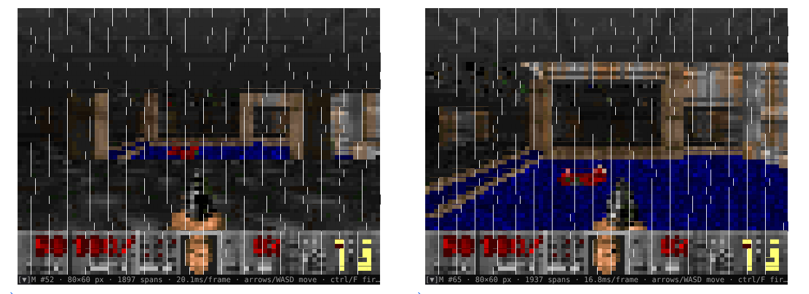
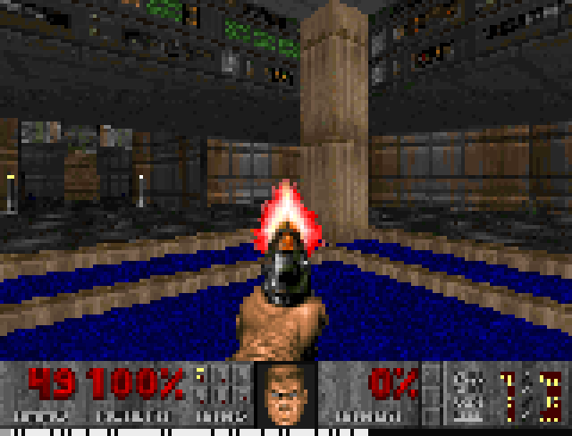
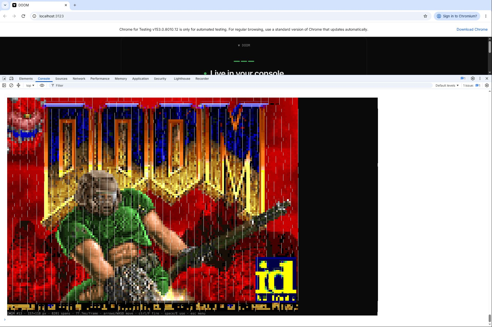

# Doom in Text.js

**Goal:** make Doom run in [Text.js](https://textjs.org), a React 19 framework whose apps render
*inside the browser DevTools console*: each frame is a single `console.log("%c…%c…", css, css, …)`.

**Result:** it works. The shareware DOOM1.WAD runs as a Text.js App Router page. Its 320×200
framebuffer is drawn with Text.js's own `<Image>` component as half-block (`▀`) cells, and you
play it in the DevTools Console with the keyboard. The same page also runs in a terminal through
`text run`, and in Text.js's offscreen test renderer.



*Headed Chromium under Xvfb, DevTools docked at the bottom, Console panel, 80×31 cells. Left: a new
game on E1M1. Right: after walking forward and turning. The dim line at the bottom is the app's HUD
(the `[▼]` dev indicator covers its first characters).*

The main finding is about performance. **The bottleneck is the DevTools Console panel, not Doom or
Text.js.** It renders about 17–22k `%c` spans per second, however those spans are split into
frames. A full-colour Doom frame is roughly one span per cell. Logging at Text.js's normal ~15 fps
therefore makes DevTools fall 10–15 seconds behind the game. Pacing frames to a span budget fixes
that.

## How it fits together

```
doomgeneric (C) --zig cc, wasm32-wasi--> doom.wasm (402 KB)
      │  tx_init / tx_tick / tx_push_key / tx_framebuffer      imports: ticks_ms, frame
      ▼
app/lib/doom-engine.js   ~150-line in-memory WASI shim (WAD in, default.cfg/savegames in memory)
      ▼
app/app/page.tsx         35 Hz clock, keyboard → Doom keys, nearest-neighbour fit to cols×rows*2
      ▼
<Image pixels fit="fill">  →  Yoga  →  CellBuffer  →  Turbolog RLE  →  console.log(%c…)
```

| Piece | What it does |
|---|---|
| `engine/doomgeneric_textjs.c` | doomgeneric platform layer. JS owns the clock, the key queue and the display. Built as a WASI *reactor* (no `main`). |
| `engine/build.sh` | Compiles the stock [ozkl/doomgeneric](https://github.com/ozkl/doomgeneric) sources with `zig cc -target wasm32-wasi` (`pip install ziglang`, no emscripten). Needs only a `system()` stub. |
| `app/lib/doom-engine.js` | Runs `doom.wasm` in the browser, Bun or Node with a minimal in-memory WASI. Doom's stdout goes to a callback (`window.doomLog`), never to the console, because the console is the screen. |
| `app/app/page.tsx` | The Text.js page: boot, game loop, input, sizing, frame pacing, HUD. |
| `app/test/doom.test.tsx` | `@textjs/app/testing`: boots, draws the title, starts E1M1 and walks. Passes (`bun test`). |
| `tools/` | Measurement harnesses: headless console capture + decode, headed DevTools screenshots + throughput, terminal replay. |

## Run it

```bash
cd textjs-doom/app
bun install
bun run wad          # fetches shareware DOOM1.WAD v1.9 (md5 f0cefca4…), not committed
bun dev              # open http://localhost:3000, then open the console (⌘⌥J / Ctrl+Shift+J)
```

Click the page so it has focus, then play. Controls: arrows or WASD to move, `Ctrl`/`F` to fire,
`Space`/`E` to use, `,` `.` to strafe, `Shift` to run, `1`–`7` for weapons, `Esc` for the menu, `Tab`
for the map. Useful settings:

- Dock DevTools at the bottom and turn **Preserve log** off (Text.js docs).
- `text.resize(80, 31)` in the DevTools prompt pins a smaller grid, which is faster.
  `text.responsive(true)` makes the grid fit the console again.
- URL parameters: `?budget=12000` sets the span budget per second (lower means less lag and fewer
  fps), and `?bits=4` quantizes colours (fewer spans, banding).
- `bun run terminal` (`text run`) plays the same page in a truecolor terminal.
- To rebuild the wasm: `engine/build.sh /path/to/doomgeneric app/public/doom.wasm`.

## Findings

### 1. Getting Doom in was the easy part
- doomgeneric compiles unmodified to wasm32-wasi with zig's bundled clang and wasi-libc.
  `-Os -s` gives 402 KB. In Node the engine runs about **3,100 tics/s, ~90× real time**.
- One gotcha: `TryRunTics` busy-waits until the clock produces a new 35 Hz tic, and there is no
  thread to sleep on. The page therefore calls `tick()` only once a new tic is due, so the wait loop
  exits immediately. A test with a frozen fake clock hangs forever.
- Text.js's `useInput` reports key presses only, never releases, and a shooter needs held keys. In
  the browser the page listens to raw `keydown`/`keyup` on `window` in the capture phase, alongside
  the focus pad's hidden textarea. In the terminal and in tests it synthesizes releases instead (a
  timeout that key-repeat keeps re-arming).
- The page pre-scales Doom's frame with nearest neighbour to exactly `cols × rows*2`, so every
  colour stays inside Doom's 256-colour palette. That gives more identical neighbours and better
  RLE than `<Image>`'s area averaging. A cell is about 1:2, so `w × 3w/8` cells gives Doom's 4:3.

### 2. What a frame costs
Captured over CDP (`Runtime.consoleAPICalled`) in headless Chromium, then decoded from the `%c`
CSS back into pixels to check the image. The decoded frame is correct:


| grid | `%c` spans/frame | payload/frame | Text.js `encodeMs`* |
|---|---|---|---|
| 80×31 | ~2.1k | ~340 KB | 12 ms |
| 100×38 | ~3.0k | ~500 KB | 19–24 ms |
| 160×61 | ~7.5k | ~1.2 MB | 40 ms (no console client) / 90–140 ms (client attached) |

\* `encodeMs` includes the `console.log` call itself. Layout (~0 ms) and raster (~1 ms) are
negligible. Production and dev builds measure the same.

- RLE barely helps on a 3D scene: spans ≈ 0.7–0.9 × cells.
- Every span repeats about 110 bytes of typography CSS
  (`font-family:"SF Mono",Menlo,…;font-size:12px;line-height:16px;margin-top:-1px;…`), so
  CSS makes up most of the payload.
- `?bits=3/4` colour quantization cuts spans by 25–30% and encode time by 2–3×, at the cost of
  visible banding.
- For comparison, `text run` in a terminal reaches **~20 fps** at 120×46 with ~27 KB per frame
  (row-diffed ANSI).

### 3. DevTools is the bottleneck, and it lags instead of dropping frames
In headed Chromium with DevTools open, my first screenshots still showed the attract-mode demo after
I had started a game. The keys had arrived (traced into `doom.key`). The Console panel was simply
**~85 frames (~15 s) behind** the page: it queues every message and works through them slowly.



To measure this, the HUD prints a frame number, and `tools/devtools-shot.mjs` reads the newest number
DevTools has *actually rendered* by walking the DevTools frontend's shadow DOM over CDP. Results
over 10 s of demo playback (`results/devtools-throughput.jsonl`):

| grid | pacing | page fps | DevTools fps | lag (frames) |
|---|---|---|---|---|
| 64×25 | none | 13.7 | 12.8 | 10 |
| 80×31 | none | 10.1 | 8.6 | 46 |
| 100×38 | none | 14.7 | 5.7 | **122** |
| 120×46 | none | 13.0 | 5.9 | **104** |
| 160×61 | none | 5.2 | 2.4 | **79** |
| 64×25 | 15k spans/s | 10.8 | 9.5 | 14 |
| 80×31 | 15k spans/s | 6.6 | 6.4 | 9 |
| 100×38 | 15k spans/s | 5.0 | 4.2 | 10 |
| 120×46 | 15k spans/s | 4.0 | 3.3 | 7 |
| 160×61 | 15k spans/s | 1.8 | 1.6 | 4 |

DevTools fps × spans comes out at roughly 17–22k spans/s at every size. So the page now sets the
frame interval to `max(66 ms, lastSpanCount / budget)`. Until Text.js reports a span count, it
assumes one span per cell; without that, the first second of frames goes out unpaced. With pacing,
lag stays flat at a few frames (≈7 in the gameplay capture above) instead of growing without bound.
For a game, a steady low frame rate is much better than a backlog. The best trade-off for play is
80×31 at ~6–9 fps.

### Caveats
- All DevTools numbers come from Chromium 153 under Xvfb with software GL, no GPU and DejaVu Sans
  Mono as the fallback font. A real desktop with SF Mono or Menlo and a GPU will be faster. The budget
  is a URL parameter for that reason.
- On this setup there are 1 px vertical seams between some spans. Spans are inline blocks, and the
  fallback font has a fractional advance (~7.2 px). I could not test with the fonts Text.js targets.
- Seeding the DevTools theme as dark in the profile did not take, so the screenshots use the light
  theme around the frame.
- `Ctrl` is fire, as in vanilla Doom, so browser shortcuts like Ctrl+W still win. Use `F` or `J`
  to fire if that bites.
- The WAD is id Software's freely redistributable shareware episode. It is fetched by a script
  rather than committed. `doom.wasm` is GPL-2.0 (doomgeneric / Chocolate Doom).

## Reproducing the measurements
```bash
# engine only (no Text.js)
node engine/smoke.mjs <dir with doom.wasm and wad/doom1.wad>
# offscreen Text.js render + render captured frames to PNG
cd app && bun test && python3 ../tools/ansi2png.py test/e1m1.ansi e1m1.png
# headless console capture + decode (needs `bun dev` on :3123)
SIZE=100x38 node tools/browser-run.mjs "http://localhost:3123/?bits=8" out/
# real DevTools under Xvfb: screenshots, or a throughput measurement
SIZE=80x31 xvfb-run -a -s "-screen 0 1920x1280x24" node tools/devtools-shot.mjs http://localhost:3123/ out/
tools/sweep-devtools.sh http://localhost:3123/ out/ "80x31 8 1e9" "80x31 8 15000"
# terminal: capture `text run` in a pty and replay it
script -q -c "stty cols 120 rows 46; timeout 10 bunx text run" term.raw; python3 tools/replay-terminal.py term.raw term.png 120 46
```
